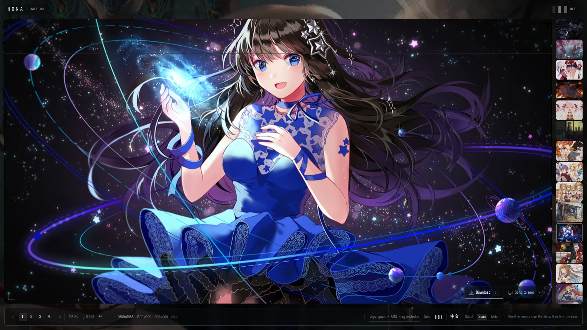

# Konachan Tauri

<p align="center">
  
</p>

<p align="center">
  <a href="https://github.com/lf-wxp/konachan-tauri/blob/main/LICENSE">
    
  </a>
  
  <a href="https://tauri.app/">
    
  </a>
  <a href="https://leptos.dev/">
    
  </a>
  <a href="https://github.com/lf-wxp/konachan-tauri/releases">
    
  </a>
  <a href="https://github.com/lf-wxp/konachan-tauri/actions">
    
  </a>
</p>

<p align="center">
  A beautiful desktop <a href="https://konachan.com/">Konachan</a> image browser built with <b>Tauri 2</b> and <b>Leptos 0.8</b>, delivering a native experience across macOS, Windows, and Linux.
</p>

<p align="center">
  <a href="./README.zh-CN.md">中文文档</a>
</p>

---

## 📋 Table of Contents

- [Konachan Tauri](#konachan-tauri)
  - [📋 Table of Contents](#-table-of-contents)
  - [✨ Features](#-features)
  - [📸 Screenshots](#-screenshots)
  - [🛠️ Tech Stack](#️-tech-stack)
  - [🏗️ Architecture](#️-architecture)
  - [📦 Prerequisites](#-prerequisites)
    - [Required Tools](#required-tools)
    - [Quick Setup](#quick-setup)
    - [Platform-Specific Dependencies](#platform-specific-dependencies)
  - [🚀 Installation](#-installation)
    - [Option 1: Clone with Submodules (Recommended)](#option-1-clone-with-submodules-recommended)
    - [Option 2: Initialize Submodules After Clone](#option-2-initialize-submodules-after-clone)
    - [Update Submodule](#update-submodule)
  - [💻 Development](#-development)
    - [Start the Desktop App](#start-the-desktop-app)
    - [Frontend Only](#frontend-only)
    - [Feature Flags](#feature-flags)
    - [Build for Production](#build-for-production)
    - [Build for Specific Platforms](#build-for-specific-platforms)
  - [⌨️ Keyboard Shortcuts](#️-keyboard-shortcuts)
  - [📁 Project Structure](#-project-structure)
  - [🔧 Troubleshooting](#-troubleshooting)
    - [Common Issues](#common-issues)
    - [Getting Help](#getting-help)
  - [🤝 Contributing](#-contributing)
    - [Development Guidelines](#development-guidelines)
  - [🔗 Related Projects](#-related-projects)
  - [📄 License](#-license)
  - [🙏 Acknowledgments](#-acknowledgments)

---

## ✨ Features

- 🖼️ **Lightbox Stage** — Full-bleed image viewer with a film-strip rail, three rail densities, and wheel / arrow-key / swipe navigation
- 🔍 **Tag Search** — Tag-based queries with shift-click tag chaining and paged results
- 🌊 **Waterfall Gallery** — Masonry layout that keeps the scroll position stable while pages load
- 📥 **Download Queue** — Downloads are handled by the Tauri backend with live progress events and per-item status
- 🎞️ **Dynamic Wallpaper** — Canvas-animated wallpaper stage on the detail view
- 🌍 **i18n** — English and Chinese UI, picked from the system language
- 🎭 **Safe Mode** — Content filter fixed at compile time (`safe` feature) or switched at runtime through `config.js`
- 🎨 **Adaptive Theme** — Base, primary, and ancillary colours extracted from the current image
- 🖥️ **Splash Screen** — Dedicated transparent Tauri window, dismissed once the WASM app is ready
- 🚀 **Cross-Platform** — Native bundles for macOS, Windows, and Linux
- 🎯 **Lightweight** — Small bundle size thanks to Tauri's system WebView

---

## 📸 Screenshots


---

## 🛠️ Tech Stack

| Layer           | Technology                                                                    | Description                                       |
| --------------- | ----------------------------------------------------------------------------- | ------------------------------------------------- |
| **Frontend**    | [Leptos 0.8](https://leptos.dev/) + [Trunk](https://trunkrs.dev/)             | Rust → WebAssembly UI framework (CSR)             |
| **Backend**     | [Tauri 2](https://tauri.app/)                                                 | Secure Rust-based desktop framework               |
| **Styling**     | SCSS compiled by Trunk                                                        | Static stylesheets, no runtime style injection    |
| **State**       | Leptos signals (`RwSignal` / `Memo`)                                          | One `AppState` context plus pure reducers         |
| **WASM Bindings** | [wasm-bindgen](https://github.com/rustwasm/wasm-bindgen), [web-sys](https://crates.io/crates/web-sys), [gloo-net](https://github.com/rustwasm/gloo) | DOM access and the HTTP transport |
| **Language**    | Rust 2024 edition (toolchain pinned to 1.94 by `rust-toolchain.toml`)         | Type-safe full-stack development                  |

---

## 🏗️ Architecture

```
┌───────────────────────────────────────────┐
│            Tauri Shell (Native)           │
│  ┌─────────────────────────────────────┐  │
│  │  WebView (Frontend - Leptos WASM)   │  │
│  │  • Components                       │  │
│  │  • AppState + pure reducers         │  │
│  │  • UI interactions                  │  │
│  └─────────────────────────────────────┘  │
│  ┌─────────────────────────────────────┐  │
│  │  Tauri Backend (Rust commands)      │  │
│  │  • get_post / Konachan API          │  │
│  │  • download_image + progress events │  │
│  │  • close_splashscreen               │  │
│  │  • dialogs, fs, notifications, …    │  │
│  └─────────────────────────────────────┘  │
└───────────────────────────────────────────┘
```

The desktop build enables the frontend's `tauri` feature, so API calls and downloads go through `invoke` instead of HTTP. The same frontend can also run as a plain web app against `konachan-api`.

---

## 📦 Prerequisites

### Required Tools

- **[Rust](https://www.rust-lang.org/tools/install)** 1.94+ — the exact channel is pinned in `src/rust-toolchain.toml`
- **[Trunk](https://trunkrs.dev/)** 0.21.14 — WASM bundler (ships the Dart Sass compiler used for the SCSS)
- **`wasm32-unknown-unknown`** target
- **[Tauri CLI](https://tauri.app/start/prerequisites/)** 2.12+ and the platform dependencies below

### Quick Setup

```bash
# Install Rust (if not already installed)
curl --proto '=https' --tlsv1.2 -sSf https://sh.rustup.rs | sh

# Install Trunk
cargo install trunk@0.21.14

# Add the WASM target
rustup target add wasm32-unknown-unknown

# Install the Tauri CLI (2.12+; older 2.0.0-rc builds pass `--features tauri/native-tls` to cargo)
cargo install tauri-cli --version "^2" --locked
```

### Platform-Specific Dependencies

<details>
<summary><b>macOS</b></summary>

```bash
# Install Xcode Command Line Tools
xcode-select --install
```

</details>

<details>
<summary><b>Windows</b></summary>

- Install [Microsoft Visual Studio C++ Build Tools](https://visualstudio.microsoft.com/visual-cpp-build-tools/)
- Install [WebView2](https://developer.microsoft.com/en-us/microsoft-edge/webview2/) (usually pre-installed on Windows 10/11)

</details>

<details>
<summary><b>Linux</b></summary>

```bash
# Ubuntu/Debian
sudo apt update
sudo apt install libwebkit2gtk-4.1-dev build-essential curl wget file libxdo-dev libssl-dev libayatana-appindicator3-dev

# Arch Linux
sudo pacman -S webkit2gtk-4.1 base-devel curl wget file xdotool openssl libappindicator-gtk3

# Fedora
sudo dnf install webkit2gtk4.1-devel curl wget file openssl-devel libappindicator-gtk3-devel
```

</details>

---

## 🚀 Installation

The frontend lives in the `src/` git submodule ([konachan-leptos](https://github.com/lf-wxp/konachan-leptos), SSH URL), so the submodule has to be checked out before building.

### Option 1: Clone with Submodules (Recommended)

```bash
# Clone the repository together with the frontend submodule
git clone --recurse-submodules git@github.com:lf-wxp/konachan-tauri.git
cd konachan-tauri

# Download the backend dependencies
cargo fetch --manifest-path src-tauri/Cargo.toml
```

### Option 2: Initialize Submodules After Clone

```bash
# Clone without submodules
git clone git@github.com:lf-wxp/konachan-tauri.git
cd konachan-tauri

# Initialize and update submodules
git submodule update --init --recursive
```

> 💡 HTTPS users can clone over HTTPS and rewrite the submodule URL on the fly:
> `git clone --recurse-submodules -c url."https://github.com/".insteadOf="git@github.com:" <repo-url>`

### Update Submodule

```bash
# Update the frontend submodule to the latest commit of its default branch
git submodule update --remote src

# Then commit the new gitlink in the parent repository
git add src && git commit -m "chore: bump frontend submodule"
```

---

## 💻 Development

### Start the Desktop App

```bash
cargo tauri dev
```

`tauri.conf.json` wires up the frontend automatically:

- `beforeDevCommand`: `trunk serve --features tauri --config src/Trunk.toml` (dev server on port 8888)
- `beforeBuildCommand`: `trunk build --release --features tauri --config src/Trunk.toml`
- `frontendDist`: `../src/dist`

Change frontend code and the Trunk dev server hot-reloads the WebView; change `src-tauri/` and Tauri rebuilds the backend and restarts the window.

### Frontend Only

The submodule is a standalone web frontend, so it can be developed without Tauri:

```bash
cd src

# Mock data, no backend needed
trunk serve --features fake

# HTTP transport against konachan-api on localhost:8000 (`/api/` is proxied)
trunk serve --features web
```

`cargo make dev-fake`, `dev-web`, `dev-safe`, `format`, `clippy`, `check`, and `test` are also available inside `src/`.

### Feature Flags

| Flag    | Effect                                                                                  |
| ------- | --------------------------------------------------------------------------------------- |
| `fake`  | Serves `static/mock/post.json` instead of calling any API                                |
| `web`   | HTTP transport (`gloo-net`) against the same-origin `/api/`                              |
| `safe`  | Compile-time default for safe mode; can still be overridden at runtime via `config.js`   |
| `tauri` | Desktop transport: API calls and downloads go through Tauri commands                    |

Pick exactly one transport per build: `web`/`safe` fetch over HTTP, `tauri` invokes the backend.

### Build for Production

```bash
cargo tauri build
```

The bundled application is written to `src-tauri/target/release/bundle/`.

### Build for Specific Platforms

<details>
<summary><b>Build Commands for Each Platform</b></summary>

```bash
# macOS (from a macOS machine)
cargo tauri build

# Windows (from a Windows machine)
cargo tauri build

# Linux (from a Linux machine)
cargo tauri build
```

⚠️ A wasm frontend plus a native backend cannot be cross-compiled in one step — build each platform on its own runner (this is what `.github/workflows/release.yml` does).

</details>

---

## ⌨️ Keyboard Shortcuts

Single-key shortcuts are ignored while a text field has focus.

| Shortcut        | Action                                                    |
| --------------- | --------------------------------------------------------- |
| `/`             | Focus the tag search field                                |
| `←` / `→`       | Previous / next image in the lightbox                     |
| `D`             | Queue the image currently shown for download              |
| `W`             | Project the image currently shown as a dynamic wallpaper  |
| `R`             | Refresh the current result set                            |
| `Esc`           | Close the lightbox overlay                                |
| `Shift` + click | Add a tag to the current query instead of replacing it    |

---

## 📁 Project Structure

```
konachan-tauri/
├── src/                          # Frontend submodule (konachan-leptos)
│   ├── src/
│   │   ├── components/           # Leptos components (stage, nav, search, setting, …)
│   │   ├── state/                # AppState + reducers (page, downloads, notices, theme, i18n)
│   │   ├── utils/                # DOM helpers, waterfall layout, canvas animations, runtime config
│   │   ├── api.rs                # Transport layer (HTTP / Tauri / mock)
│   │   ├── app.rs                # Root component (providers + layout)
│   │   ├── model.rs              # Data models and types
│   │   └── main.rs               # Frontend entry point
│   ├── static/                   # SCSS, fonts, images, mock data, splash, scripts
│   ├── index.html                # Trunk asset manifest
│   ├── Cargo.toml                # Frontend dependencies and features
│   ├── Trunk.toml                # Dev server (8888) and `/api/` proxy
│   └── rust-toolchain.toml       # Pinned toolchain (1.94) and wasm target
│
├── src-tauri/                    # Tauri backend
│   ├── src/
│   │   ├── main.rs               # Plugins and application setup
│   │   ├── lib.rs                # Command registration
│   │   ├── commander.rs          # get_post / download_image / close_splashscreen
│   │   └── image.rs              # Konachan API client, parsing, download + progress
│   ├── capabilities/             # Tauri permission capabilities
│   ├── icons/                    # App icons (png, ico, icns)
│   ├── Cargo.toml                # Backend dependencies
│   └── tauri.conf.json           # Tauri configuration
│
├── .github/
│   └── workflows/
│       └── release.yml           # CI/CD release workflow
│
├── LICENSE                       # MIT License
├── README.md                     # This file
├── README.zh-CN.md               # Chinese documentation
└── .gitmodules                   # Git submodule configuration
```

---

## 🔧 Troubleshooting

### Common Issues

<details>
<summary><b>❌ `cargo tauri dev` fails with a WebView error</b></summary>

**Solution**:
- **macOS**: Ensure Xcode Command Line Tools are installed (`xcode-select --install`)
- **Linux**: Install the `webkit2gtk` development packages
- **Windows**: Install the [WebView2 Runtime](https://developer.microsoft.com/en-us/microsoft-edge/webview2/)

</details>

<details>
<summary><b>❌ `trunk` command not found</b></summary>

**Solution**:
```bash
cargo install trunk@0.21.14
```

If it is still not found, ensure `~/.cargo/bin` is in your `PATH`.

</details>

<details>
<summary><b>❌ Submodule not initialized / `src` is empty</b></summary>

**Solution**:
```bash
git submodule update --init --recursive
```

Clones created before the frontend moved to `konachan-leptos` still hold the old
URL in `.git/config`, so `update` fails with `repository not found`. Re-apply
the URL from `.gitmodules` first:

```bash
git submodule sync --recursive
git submodule update --init --recursive
```

</details>

<details>
<summary><b>❌ `Permission denied (publickey)` while cloning submodules</b></summary>

The submodule is referenced over SSH (`git@github.com:lf-wxp/konachan-leptos.git`).

**Solution**:
```bash
# Use your GitHub SSH key
ssh -T git@github.com

# Or rewrite the URL for a single clone
git -c url."https://github.com/".insteadOf="git@github.com:" submodule update --init --recursive
```

</details>

<details>
<summary><b>❌ Build fails with Rust compilation errors</b></summary>

**Solution**:
```bash
# Update the toolchain (the project pins 1.94 via rust-toolchain.toml)
rustup update

# Clean and rebuild
cargo clean
cargo tauri build
```

</details>

<details>
<summary><b>❌ `cargo tauri dev` fails with `failed to select a version for schannel`</b></summary>

`tauri-cli` 2.0.0-rc.\* builds the backend with `--features tauri/native-tls`, which drags in `native-tls` → `schannel ^0.1.28` and cannot be resolved against the locked crate versions. Nothing is wrong with the project itself.

**Solution**:
```bash
# Upgrade to a stable 2.x CLI, which builds with `cargo run --no-default-features`
cargo install tauri-cli --version "^2" --locked
cargo tauri --version
```

Alternatively use the npm CLI: `bunx @tauri-apps/cli@2 dev` / `npx @tauri-apps/cli@2 dev`.

</details>

<details>
<summary><b>❌ `cargo tauri dev` hangs on `Waiting for your frontend dev server to start on http://localhost:8888/`</b></summary>

Port 8888 is already taken, usually by a `trunk serve` left running from an earlier session.

**Solution**:
```bash
lsof -nP -i :8888   # find the PID
kill <pid>
```

</details>

<details>
<summary><b>❌ Link step runs out of memory</b></summary>

The frontend release profile uses `lto = "fat"` with a single codegen unit, which is the peak-memory point of the link. On a constrained builder, override it on the command that actually links:

```bash
# run from the repository root
CARGO_PROFILE_RELEASE_LTO=off trunk build --release --features tauri --config src/Trunk.toml
```

</details>

### Getting Help

If you encounter issues not listed here:
1. Check the [Issues](https://github.com/lf-wxp/konachan-tauri/issues) page
2. Open a new issue with detailed error information

---

## 🤝 Contributing

Contributions are welcome! Here's how you can help:

1. **Fork** the repository
2. **Create** a feature branch (`git checkout -b feature/amazing-feature`)
3. **Commit** your changes (`git commit -m 'Add some amazing feature'`)
4. **Push** to the branch (`git push origin feature/amazing-feature`)
5. **Open** a Pull Request

Frontend work happens in the [konachan-leptos](https://github.com/lf-wxp/konachan-leptos) repository (the `src/` submodule); open frontend pull requests there.

### Development Guidelines

- Follow the existing code style (`rustfmt` + `clippy`, both configured in the repository)
- Write meaningful commit messages
- Add tests for new features
- Update documentation as needed

---

## 🔗 Related Projects

| Project | Description | Link |
| ------- | ----------- | ---- |
| **konachan-leptos** | Frontend submodule (Leptos + WASM) | [GitHub](https://github.com/lf-wxp/konachan-leptos) |
| **konachan-api** | Backend API server for the web version | [GitHub](https://github.com/lf-wxp/konachan-api) |
| **Konachan** | The image board this app is based on | [Website](https://konachan.com/) |

---

## 📄 License

This project is licensed under the **MIT License**. See the [LICENSE](./LICENSE) file for details.

---

## 🙏 Acknowledgments

- [Konachan](https://konachan.com/) for providing the API
- [Tauri](https://tauri.app/) for the amazing desktop framework
- [Leptos](https://leptos.dev/) for the Rust WASM framework
- All contributors who have helped this project

---

<p align="center">
  Made with ❤️ by <a href="https://github.com/lf-wxp">lf-wxp</a>
</p>

<p align="center">
  ⭐ Star this repo if you find it useful!
</p>
